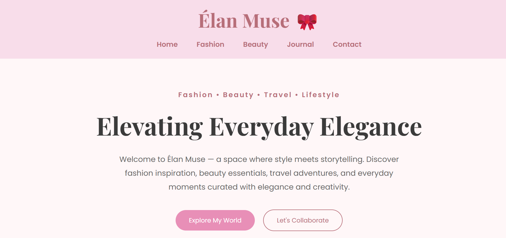
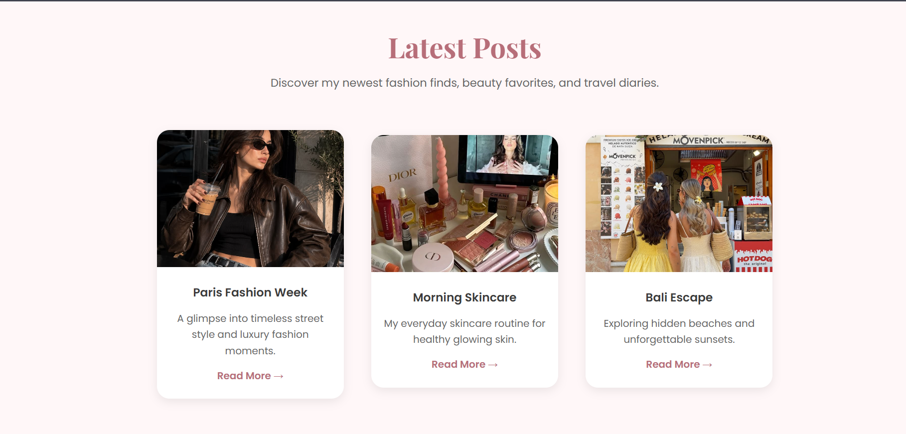
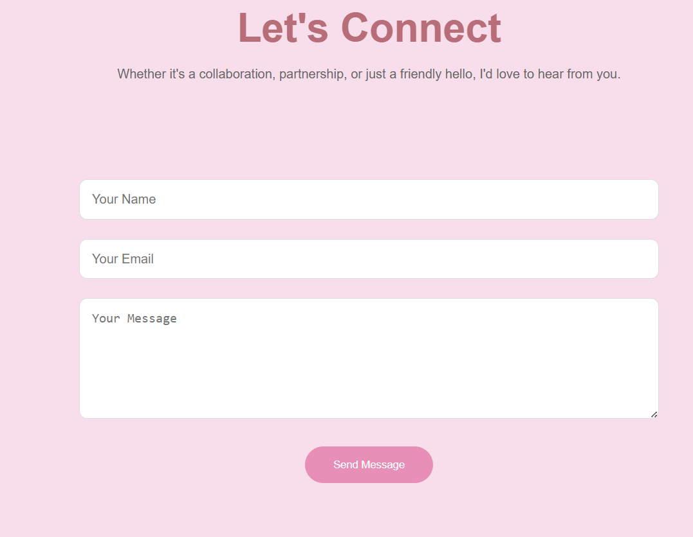

# 🌸 Élan Muse

A modern, elegant, and responsive lifestyle influencer website inspired by luxury fashion and beauty blogs.

## ✨ Overview

Élan Muse is a frontend project created using **HTML5** and **CSS3**. The website represents a fictional lifestyle influencer with dedicated pages for fashion, beauty, journaling, and contact.

---

## 📸 Preview

### Home

### Fashion

### Beauty

### Journal

### Contact

---

## 🚀 Features

- Elegant pastel-themed UI
- Multi-page website
- Responsive navigation
- Hero section
- Fashion showcase
- Beauty essentials
- Personal journal
- Contact form
- Clean and modern design

---

## 🛠️ Built With

- HTML5
- CSS3
- Google Fonts
- Font Awesome

---

## 📂 Pages

- 🏠 Home
- 👗 Fashion
- 💄 Beauty
- 📖 Journal
- 📩 Contact

---

## 🎨 Color Palette

| Color | Hex |
|--------|------|
| Blush Pink | `#E88FB7` |
| Soft Pink | `#FFF7F8` |
| Rose | `#B76E79` |
| White | `#FFFFFF` |
| Dark Gray | `#3B3B3B` |

---

## 👩‍💻 Author

Sneha Gouda
